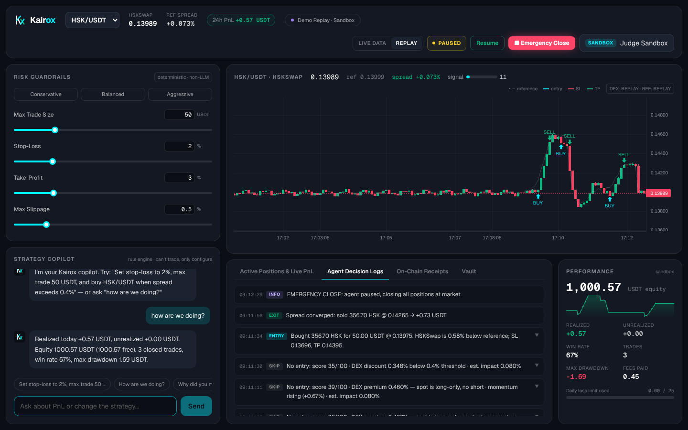
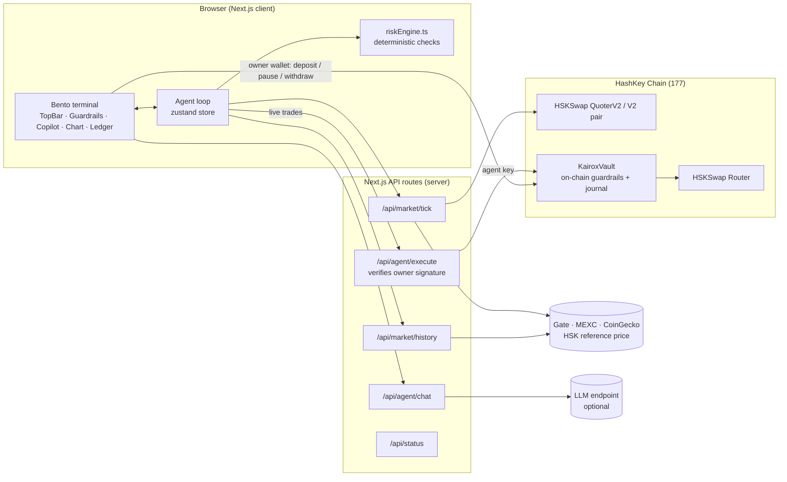

<div align="center">

# Kairox

**Autonomous AI trading terminal for HSKSwap on HashKey Chain — the agent can't lose more than the limits you set.**

Built for **Track 1: AI Agent Trading** · HSK Chain Horizon Hackathon · Seoul (Dec 2026)

`Next.js 15` · `TypeScript` · `Solidity 0.8.24` · `viem / wagmi` · `Privy v3` · `lightweight-charts` · `HashKey Chain (177)`



</div>

---

## Table of contents

- [What it does](#what-it-does)
- [Why it is different: KairoxVault](#why-it-is-different-kairoxvault)
- [How it maps to Track 1](#how-it-maps-to-track-1)
- [Architecture](#architecture)
- [Safety model](#safety-model)
- [Quick start (WSL / Ubuntu / macOS)](#quick-start-wsl--ubuntu--macos)
- [Judge demo in 3 minutes](#judge-demo-in-3-minutes)
- [Going live on HashKey Chain mainnet](#going-live-on-hashkey-chain-mainnet)
- [Headless agent worker](#headless-agent-worker)
- [Deploying to Vercel](#deploying-to-vercel)
- [Environment variables](#environment-variables)
- [Repository layout](#repository-layout)
- [Testing](#testing)
- [Honest limitations](#honest-limitations)
- [Roadmap](#roadmap)

---

## What it does

Kairox replaces chart-watching and manual order entry with an **autonomous agent you supervise**:

| | |
|---|---|
| **Market monitoring** | Every few seconds the agent quotes **HSKSwap** on-chain (QuoterV2 / V2 reserves) and compares it to an external HSK spot reference (Gate → MEXC → CoinGecko). It computes the spread, short-term momentum (EMA 8/30), volatility and the price impact of the next trade. |
| **Autonomous execution** | When HSKSwap trades at a discount to the reference and the signal score clears your threshold, the agent buys. Every open position is checked on every tick for **stop-loss**, **take-profit** or **spread convergence**, and exits automatically. |
| **Deterministic guardrails** | A plain-arithmetic risk engine (no LLM) checks every trade: max trade size, max slippage, daily loss limit, max open positions/exposure, entry cooldown, pause state. Every decision is logged with the pass/fail result of each rule. |
| **Strategy copilot** | Type *"Set stop-loss to 2%, max trade 50 USDT, and buy HSK/USDT when spread exceeds 0.4%"* and watch the sliders move. Ask *"how are we doing?"* or *"why did you make the last trade?"*. The copilot **can only propose settings**: it never trades, and everything it proposes is clamped to hard limits and the vault's on-chain limits. |
| **On-chain vault** | In live mode the agent trades through **KairoxVault**, a contract that enforces the core limits *on-chain* and lets only the owner withdraw or pause. |
| **On-chain decision journal** | Each live trade stores a `keccak256` hash of the agent's decision record (prices, spread, score, reasoning, settings) in the vault's `TradeExecuted` event. You can check that the reasoning shown in the terminal is exactly what the agent committed to before trading. |
| **One-step onboarding** | Google, X, email OTP, passkeys (Privy embedded wallets), or OKX Wallet / MetaMask / WalletConnect, plus a **Judge Sandbox** with 1,000 simulated USDT and a scripted **Demo Replay**. |

Kairox is **long-only spot** and does **spread / mean-reversion trading**: it bets that a DEX discount to the reference converges. It is *not* risk-free arbitrage, since it does not trade the reference venue. The UI and logs say so plainly.

---

## Why it is different: KairoxVault

Most trading bots hold a private key on a server and *promise* to respect risk limits in their own code. If the server is hacked or the LLM is prompt-injected, the promise is worthless.

Kairox splits the roles:

```
 Owner wallet ──deposit / withdraw / pause / set limits──▶ KairoxVault ◀──executeTrade (only)── Agent key (server)
                                                               │
                                                               └── HSKSwap router (output must come back to the vault)
```

| The agent (operator) **can** | The agent **cannot** |
|---|---|
| Swap allowlisted tokens ↔ USDT through the owner-approved HSKSwap router | Withdraw anything, ever |
| Open positions up to `maxTradeQuote` each and `maxOpenExposureQuote` in total | Trade while the vault is paused |
| Exit positions at any time (even after the loss limit) | Open new positions after the **daily loss limit** is hit (resets 00:00 UTC) |
| | Route swap output anywhere but the vault (the balance-delta check reverts) |
| | Get more token approval than the exact trade amount |
| | Accept worse than `maxSlippageBps` vs. a Chainlink-style price feed (when one is configured) |

**Pitch line:** *Even if our AI or our server is compromised, it cannot lose more than your limits.*

Contract: [`contracts/contracts/KairoxVault.sol`](contracts/contracts/KairoxVault.sol) · 17 tests: [`contracts/test/KairoxVault.test.ts`](contracts/test/KairoxVault.test.ts)

---

## How it maps to Track 1

| Track 1 asks for… | Kairox |
|---|---|
| Agent for automated trading on a DEX such as HSKSwap | HSKSwap V3 (`SwapRouter02` / `SwapRouter`) or V2 router, selectable by env |
| Monitor markets, analyze on-chain data, identify signals, execute autonomously | `/api/market/tick` + `signals.ts` + agent loop in `agentStore.ts` / `scripts/agent-worker.ts` |
| Spot arbitrage and spread opportunities in real time | DEX-vs-reference spread, with price impact quoted on-chain for the actual trade size |
| Sustained profitability with strict risk controls and stop-loss | Deterministic risk engine **plus** on-chain vault limits; SL/TP/convergence exits every tick; performance card with win rate, drawdown, fees |
| Conversational interface for positions and PnL | Strategy Copilot (LLM or rule-based) answers with live snapshot data |
| Adjust position size, frequency, risk appetite, target assets | Chat or sliders: `maxTradeUsd`, `scanIntervalSec`, presets (conservative / balanced / aggressive), `pairs` |
| Deploy on HSK Chain mainnet | `npm run deploy:mainnet` in `contracts/` deploys KairoxVault to chain 177 |

---

## Architecture



**Execution modes**

| Mode | When | Market data | Fills |
|---|---|---|---|
| **Judge Sandbox** | no setup | live reference price + simulated HSKSwap spread (synthetic if offline) | simulated, 1,000 USDT, 0.3% fee + impact |
| **Live HSKSwap · Sandbox Execution** | HSKSwap + token addresses set | real on-chain HSKSwap quotes | simulated |
| **Demo Replay** | `Replay` toggle | scripted 200-second market | simulated |
| **Live · HashKey Chain** | vault deployed + `AGENT_PRIVATE_KEY` + owner signs once | real on-chain quotes | real swaps through KairoxVault, explorer links |

The top-bar indicator always shows the current mode; click it to see exactly which settings are missing.

---

## Safety model

Three layers. Each layer assumes the one above it can fail.

1. **Copilot (LLM), untrusted.** Can only output a config patch and `pause | resume | close_all`. The patch is validated and clamped by `clampConfigPatch` (hard limits, plus vault limits in live mode). Try *"set max trade to 1000000 USDT"*: it is capped and the copilot tells you why.
2. **Risk engine (TypeScript, deterministic).** `validateEntry` and `evaluateExit` in [`riskEngine.ts`](src/lib/agent/riskEngine.ts). Every rule's result is shown in *Agent Decision Logs*.
3. **KairoxVault (Solidity, on-chain).** Re-checks size, exposure, daily loss, cooldown, allowlist, pause and output, whatever the off-chain code says.

Additional measures:
- The agent key lives **only on the server** and is the vault's *operator*, never its owner.
- `/api/agent/execute` only trades after the browser proves vault ownership with a signed, expiring session message (verified against `vault.owner()` on-chain).
- Pausing stops new entries but **keeps stop-loss/take-profit protection running**. **Emergency Close** pauses and flattens everything. The **on-chain pause** in the Vault tab is a hard stop the server cannot override.
- Contract addresses are **never hardcoded**: they are read from env and validated at startup. A missing address falls back to sandbox mode; it never crashes the app.

---

## Quick start (WSL / Ubuntu / macOS)

Requirements: **Node.js 20+** and npm. On Windows, use WSL (Ubuntu).

```bash
# Windows only: open PowerShell →  wsl --install -d Ubuntu  → reboot → open "Ubuntu"
# inside Ubuntu / macOS:
curl -fsSL https://deb.nodesource.com/setup_20.x | sudo -E bash -   # Ubuntu
sudo apt-get install -y nodejs git                                   # Ubuntu

git clone https://github.com/Black-Samson/kairox.git
cd kairox
npm install
cp .env.example .env.local        # everything optional for the sandbox
npm run dev                       # http://localhost:3000
```

Click **Preview in Judge Sandbox Mode →**. No wallet, gas or keys needed.

> Keep the project inside the Linux filesystem (`~/kairox`), not `/mnt/c/...`, for fast installs and hot reload under WSL.

Optional:
- `LLM_API_KEY` (OpenRouter or any OpenAI-compatible endpoint, or Anthropic) for the LLM copilot. Without it, a deterministic parser handles the common commands.
- `NEXT_PUBLIC_PRIVY_APP_ID` (free at [dashboard.privy.io](https://dashboard.privy.io)) turns on Google, X, email OTP and passkeys with embedded wallets. In the Privy dashboard, enable those login methods and add your domain (and `http://localhost:3000`) to allowed origins.

---

## Judge demo in 3 minutes

1. Open the app → **Preview in Judge Sandbox Mode**.
2. Click **Replay** in the top bar. The scripted market plays four acts in about 200 seconds:
   - **Act 1:** HSKSwap lags a rally → agent buys the discount → **take-profit**.
   - **Act 2:** discount in a calm market → market dumps → **stop-loss** fires automatically.
   - **Act 3:** HSKSwap trades at a **premium** → long-only agent logs the skip.
   - **Act 4:** clean discount closes → **spread-converged** exit.
3. While it runs, type in the copilot:
   - `Set stop-loss to 1.5%, max trade 80 USDT, and buy HSK/USDT when spread exceeds 0.45%` → sliders flash and move.
   - `Set max trade to 1000000 USDT` → capped by the hard limit, with an explanation.
   - `How are we doing?` / `Why did you make the last trade?`
4. Open **Agent Decision Logs** and expand an entry: signal breakdown, every guardrail ✓/✕, and the decision-journal hash.
5. Hit **Emergency Close**.
6. Open **Vault** to show the on-chain limits. In live mode, open **On-Chain Receipts** and click through to `explorer.hsk.xyz`.

---

## Going live on HashKey Chain mainnet

> Use small amounts. Start on testnet (`NEXT_PUBLIC_HSK_NETWORK=testnet`, `npm run deploy:testnet`).

**1. Collect addresses.** From HSKSwap / HashKey docs or the explorer, paste into `.env.local`: router, quoter (V3 QuoterV2, or the V2 factory), WHSK, USDT, and set `NEXT_PUBLIC_HSKSWAP_VERSION` and the fee tier of the pool you trade. **Never guess an address.**

**2. Create two wallets.**
- **Owner:** your normal wallet. Deploys the vault, deposits, withdraws, pauses.
- **Agent:** a fresh hot wallet whose key goes in `AGENT_PRIVATE_KEY`. It only needs a little HSK for gas.

**3. Deploy KairoxVault**

```bash
cd contracts
npm install
cp .env.example .env          # DEPLOYER_PRIVATE_KEY = owner key, plus addresses below
# VAULT_QUOTE_TOKEN=<USDT>  HSKSWAP_ROUTER=<router>  AGENT_OPERATOR_ADDRESS=<agent address>
# VAULT_BASE_TOKENS=<WHSK>  VAULT_MAX_TRADE=50  VAULT_DAILY_LOSS=25 ...
npm test                      # 17 passing
npm run deploy:mainnet        # writes deployments/hashkey.json
```

Optionally verify on the explorer: `npx hardhat verify --network hashkey <vault> <owner> <usdt> <router> <operator> "[...limits]"`.

**4. Configure the app.** Set `NEXT_PUBLIC_KAIROX_VAULT_ADDRESS` and `AGENT_PRIVATE_KEY` in `.env.local`, then restart. The top-bar indicator should read *Live HSKSwap · Sandbox Execution*, with no issues listed.

**5. Fund and enable.** Connect the **owner** wallet → **Vault** tab → **Deposit USDT** → **Enable live trading (sign once)**. The indicator switches to **Live · HashKey Chain** and receipts link to `explorer.hsk.xyz/tx/…`.

**Optional oracle check:** if a Chainlink-style HSK/USD feed exists on HashKey Chain, call `vault.setPriceFeed(WHSK, feed)` from the owner. From then on the vault rejects any swap whose `minAmountOut` is worse than `maxSlippageBps` from the oracle price, and rejects stale prices.

---

## Headless agent worker

The browser loop is ideal for demos. For 24/7 operation, run the same engine without a browser:

```bash
npm run agent                                   # sandbox fills, prints decisions
AGENT_CONFIG='{"maxTradeUsd":25,"stopLossPct":1.5}' npm run agent -- --live   # trades via the vault
```

Every decision is appended to `agent-journal.jsonl` with its decision hash.

---

## Deploying to Vercel

1. Push the repo to GitHub → **New Project** on Vercel → import it (the framework is detected automatically).
2. Add the environment variables from `.env.example` in **Settings → Environment Variables**. Mark `AGENT_PRIVATE_KEY` and `LLM_API_KEY` as server-only (no `NEXT_PUBLIC_` prefix, which is already the case).
3. Deploy. Add the Vercel domain to Privy's allowed origins.
4. `contracts/` is ignored by the Next.js build (`tsconfig` excludes it), so Vercel only builds the app.

`/api/agent/execute` uses `maxDuration = 60` to wait for the transaction receipt. On the Vercel Hobby plan, functions are capped lower, so use the headless worker for live trading there.

---

## Environment variables

See [`.env.example`](.env.example) for the annotated list. Summary:

| Variable | Scope | Purpose |
|---|---|---|
| `NEXT_PUBLIC_HSK_NETWORK` | public | `mainnet` (177) or `testnet` (133) |
| `NEXT_PUBLIC_HSKSWAP_VERSION` / `_ROUTER_ADDRESS` / `_QUOTER_ADDRESS` / `_FEE_TIER` / `_V3_ROUTER_TYPE` | public | HSKSwap integration |
| `NEXT_PUBLIC_WHSK_ADDRESS` / `_USDT_ADDRESS` / `_USDC_ADDRESS` | public | tokens |
| `NEXT_PUBLIC_KAIROX_VAULT_ADDRESS` | public | deployed vault |
| `AGENT_PRIVATE_KEY` | **server** | vault operator key |
| `NEXT_PUBLIC_PRIVY_APP_ID`, `NEXT_PUBLIC_WALLETCONNECT_PROJECT_ID` | public | auth |
| `LLM_API_KEY`, `LLM_BASE_URL`, `LLM_MODEL` | **server** | copilot |
| `REFERENCE_SOURCES`, `REFERENCE_OFFLINE`, `HSK_RPC_URL` | server | data sources |

---

## Repository layout

```
kairox/
├── contracts/                     Hardhat project (Solidity 0.8.24, OpenZeppelin 5)
│   ├── contracts/KairoxVault.sol  on-chain guardrails + decision journal
│   ├── contracts/mocks/           test token, router, price feed
│   ├── test/                      17 tests (viem + chai)
│   └── scripts/deploy.ts          testnet / mainnet deploy
├── scripts/
│   ├── agent-worker.ts            headless 24/7 agent
│   └── export-abi.mjs             copy the vault ABI into the app
├── src/
│   ├── app/                       Next.js App Router, layout, favicon
│   │   └── api/                   market/tick · market/history · agent/chat · agent/execute · status
│   ├── components/
│   │   ├── brand/KairoxLogo.tsx   Kx monogram + wordmark
│   │   ├── auth/                  KairoxAuthModal (Privy headless + wallet fallback)
│   │   └── terminal/              TopBar · RiskGuardrailsPanel · AgentChatPanel · KairoxChart
│   │                              PositionsLedger · VaultPanel · PerformanceCard · Terminal
│   ├── config/                    chains (177/133) · contracts (env validation) · pairs
│   ├── lib/
│   │   ├── agent/                 riskEngine · signals · copilot · journal · types
│   │   ├── chain/                 executor · quoter · session · ABIs · public client
│   │   └── market/                reference prices · tick builder · replay · synthetic market
│   ├── providers/Web3Provider.tsx Privy v3 + wagmi (wallet-only fallback)
│   └── store/                     agent loop & ledger (zustand) · status refresh
└── docs/screenshots/
```

---

## Testing

```bash
cd contracts && npm test          # KairoxVault: limits, pause, loss halt, oracle, router abuse
cd .. && npm run typecheck && npm run build
```

If your network blocks the Solidity compiler download, `npm run test:offline` compiles with the bundled solc-js.

---

## Honest limitations

- **Spread trading, not risk-free arbitrage.** The reference price comes from centralized exchanges that Kairox does not trade on.
- **Thin liquidity.** HSKSwap pools may be shallow. The agent quotes the price impact for the actual trade size and rejects trades above `maxSlippagePct`, but small sizes are wise.
- **Browser loop.** The terminal's agent runs while the tab is open. Use the headless worker for 24/7 trading. Sandbox positions are not persisted across reloads; live positions live in the vault.
- **Oracle check is optional.** Without a price feed set on the vault, on-chain slippage protection is the `minAmountOut` computed from a fresh quoter call just before each trade.
- **HSK/USDC** can be monitored and traded in the sandbox; live trading uses the vault's quote token (USDT).

---

## Roadmap

- Multiple vaults per user, with a vault factory
- TWAP-based on-chain slippage floor from the HSKSwap pool itself
- Telegram alerts for entries, exits and loss-limit hits
- Backtesting on recorded HSKSwap swap events
- Multi-hop routing and more HSK Chain pairs

---

## License

MIT © 2026 Odefunso (Black-Samson)
